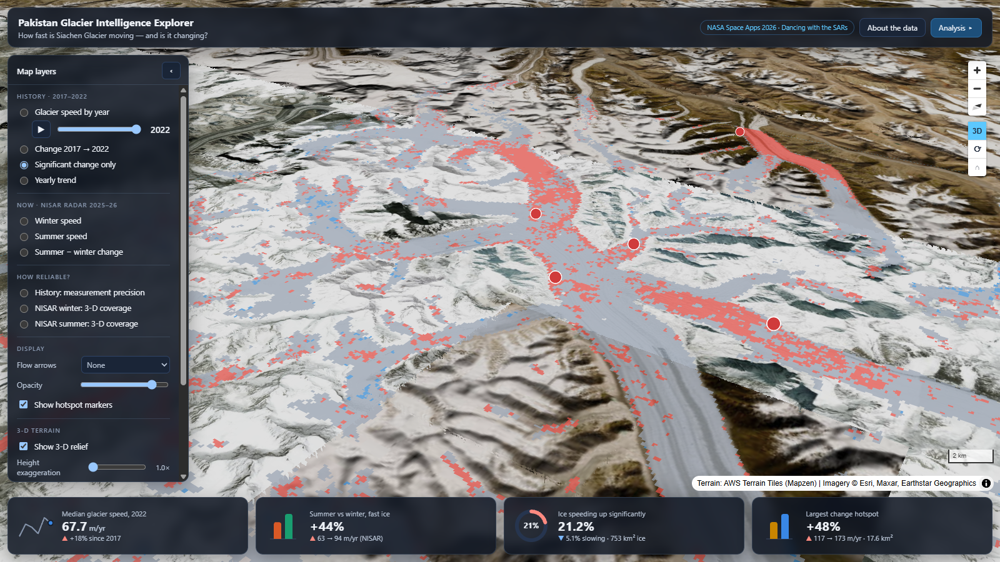

# Pakistan Glacier Intelligence Explorer

**How fast is Siachen Glacier moving — and is it changing?**
An interactive map and analysis pipeline that measures the surface velocity of Siachen Glacier (Karakoram) using
NASA–ISRO **NISAR** L-band radar (2025–26) and NASA **ITS_LIVE** (2017–2022).

*NASA Space Apps Challenge 2026 — “Dancing with the SARs”.*

🌐 **Live app:** _link added after publishing (GitHub Pages)_
📄 **Team handbook:** [`docs/Pakistan_Glacier_Intelligence_Explorer_Report.docx`](docs/Pakistan_Glacier_Intelligence_Explorer_Report.docx)



---

## Key findings

| Finding | Value | Source |
|---|---|---|
| Median glacier speed, 2022 | **67.7 m/yr** (+18 % since 2017) | ITS_LIVE |
| Summer vs winter speed, fast ice (same locations) | **63 → 94 m/yr (+44 %)** | NISAR, 7 pairs |
| Glacier ice that sped up beyond measurement error, 2017–2022 | **21.2 %** (5.1 % slowed) | ITS_LIVE |
| Largest change hotspot (upper Siachen trunk) | **17.6 km², 117 → 173 m/yr (+48 %)** | ITS_LIVE |
| NISAR flow direction vs ITS_LIVE (median difference) | **7° winter / 10° summer** | Validation |

> **What it does not measure:** glacier thinning or thickening. Colours show horizontal ice speed; the 3-D view uses a
> present-day terrain model for display only. Vertical motion was computed but is too noisy (≈ ±18 m/yr) to report.

---

## The web app

A static site (no server, no build step) — MapLibre GL 5.6 + a small custom SVG chart library.

| Feature | Details |
|---|---|
| Globe fly-in intro | Starts on a 3-D globe and flies to Siachen; **Skip** button; skipped automatically with *reduce motion* |
| Map layers | ITS_LIVE speed by year (with ▶ play), change 2017→2022, significant change, trend · NISAR winter / summer / seasonal change · reliability layers · flow arrows |
| Analysis drawer | Speed at a point (± error), speed along the glacier (yellow dot follows on the map), change-hotspot table (click to fly) |
| Headline tiles | Four key numbers with honest mini-graphics (sparkline, before/after bars, share-of-ice ring) |
| 3-D relief | Off by default · 1–2× *visual* exaggeration · one-turn orbit · Reset view · automatic fallback to 2-D |
| Methodology panel | Data, dates, resolution, CRS, velocity method, quality filters, validation and limitations — numbers read from `results/` |
| Removable widgets | Clear pin / Clear line buttons, **Esc** clears all; nothing is auto-placed on load |
| Responsive | Tested from 320 px phones to desktops with no horizontal scrolling |

### Run locally
```powershell
cd "D:\Pakistan Glacier Intelligence Explorer"
.venv\Scripts\python -m http.server 8765 -d app
```
Open http://127.0.0.1:8765. Internet is needed for the satellite basemap, the MapLibre library and (only when 3-D is on)
AWS Terrain Tiles. Any static web server works — the `app/` folder is self-contained.

### Publish an update to the live site
The live site is served by GitHub Pages from the `gh-pages` branch, which contains only the `app/` folder.
After changing anything in `app/` and committing to `main`, run:
```powershell
git push origin main
git subtree push --prefix app origin gh-pages
```
GitHub Pages refreshes the site within a minute or two.

---

## Data

| Dataset | Use | Resolution / CRS | Where |
|---|---|---|---|
| **NISAR L2 GOFF** (NASA/JPL–ISRO, DOI 10.5067/NIL2GOFF-B1) | Primary — current velocity, seasonal change | 80 m · UTM 43N (EPSG:32643) | 7 pairs, 12 days each, tracks 55 (ascending) & 135 (descending), Nov 2025 – Aug 2026 |
| **ITS_LIVE v2.1** annual mosaics (NASA MEaSUREs, JPL) | History 2017–2022, validation | 120 m · ESRI:102027 | region RGI 14A, 7 variables × 6 years = 42 GeoTIFFs |
| AWS Terrain Tiles (Mapzen) | 3-D display only | — | streamed |
| Esri World Imagery | Basemap only | — | streamed |

**Raw data is not in this repository** (≈ 22 GB). To reproduce:
- **NISAR:** in [ASF Vertex](https://search.asf.alaska.edu/) choose *List Search* and paste the file names from
  [`data/nisar_download_list.txt`](data/nisar_download_list.txt); save the `.h5` files to `data/nisar/` (keep the names).
- **ITS_LIVE:** from the [ITS_LIVE portal](https://its-live.jpl.nasa.gov/), download the v2.1 annual 120 m mosaics for
  region RGI14A, years 2017–2022, variables `v, vx, vy, v_error, vx_error, vy_error, count`, into `data/its_live/<year>/`.

---

## Repository layout
```
app/                    the web app (index.html, app.js, charts.js, style.css, data/ = exported layers)
src/pgie/               processing library
  common.py             paths, study area, raster helpers
  nisar.py              GOFF crop → cull → bias-correct → common grid → asc/desc velocity inversion
  analysis.py           trend + standard error, significance test, hotspot labelling, least-cost centreline
notebooks/              01 inspection · 02 ITS_LIVE + first NISAR · 03 multi-track seasonal NISAR · 04 hotspots & uncertainty
scripts/                export_web_layers.py · build_notebook_03/04.py · build_report.py
tests/                  test_inversion.py — recovers a known synthetic velocity field
results/                CSV tables and figures produced by the notebooks
docs/                   team handbook (.docx) and screenshots
data/                   raw downloads (git-ignored) + nisar_download_list.txt
processed/              derived GeoTIFFs (git-ignored, regenerated by the notebooks)
```

## Reproduce the analysis

1. **Environment** (Python 3.11):
   ```powershell
   uv venv .venv --python 3.11      # or: py -3.11 -m venv .venv
   uv pip install --python .venv\Scripts\python.exe -r requirements.txt
   .venv\Scripts\python -m ipykernel install --user --name pgie-venv --display-name "Python 3 (.venv PGIE)"
   ```
2. **Notebooks** (kernel “Python 3 (.venv PGIE)”), in order:
   1. `01_data_inspection` — inventory, metadata, coverage check
   2. `02_siachen_preprocessing_velocity` — crop & quality-filter ITS_LIVE, change and trend
   3. `03_nisar_multitrack_seasonal` — all NISAR pairs, seasonal stacks, ascending + descending inversion, validation
   4. `04_change_hotspots_uncertainty` — reliability, significant change, hotspots, centreline
3. **Refresh the web app:** `.venv\Scripts\python scripts\export_web_layers.py`
4. **Refresh the handbook (optional):** `.venv\Scripts\python scripts\build_report.py`
5. **Test the velocity maths:** `.venv\Scripts\python tests\test_inversion.py`

After adding new NISAR files, re-run notebooks 03 and 04, then step 3.

## Method in brief
- **NISAR → velocity:** remove invalid/water pixels, SNR < 5, offsets > 30 m and neighbourhood outliers; subtract each pair's
  stable-rock bias; project along-track and slant-range offsets to ground motion with the product's radar unit vectors
  (surface-parallel flow where one direction exists, least-squares east/north/up where ascending + descending overlap);
  ÷ 12 days × 365.25; median-stack per season and direction.
- **ITS_LIVE quality:** ≥ 5 image pairs, error ≤ 20 m/yr or ≤ 25 % of speed, speed < 1,500 m/yr.
- **Significant change:** 2017–2022 trend ≥ 2 standard errors **and** 2017→2022 change ≥ 2 × combined error.
  **Hotspots** = connected significant areas ≥ 0.25 km².
- **Seasons:** winter = Nov–Apr (4 pairs), summer = May–Oct (3 pairs); summer − winter only where both were measured.

Full details, figures and limitations: see the team handbook in `docs/` or the in-app methodology panel.

## Limitations
- NISAR (2025–26) and ITS_LIVE (2017–22) do not overlap in time; we compare spatial patterns.
- Summer NISAR has gaps on the upper glacier (wet snow); single-direction areas assume surface-parallel flow.
- Vertical motion / thinning is not reported. NISAR products are early Beta/Provisional releases.

## Team
This is a **team project** for the NASA Space Apps Challenge 2026.

| Member | Role |
|---|---|
| Abdul Basit | |
| _(add teammates here)_ | |

## Credits
- NISAR L2 GOFF: NASA/JPL–ISRO, distributed by the Alaska Satellite Facility DAAC — DOI 10.5067/NIL2GOFF-B1
- ITS_LIVE v2.1: NASA MEaSUREs Inter-mission Time Series of Land Ice Velocity and Elevation, JPL
- Terrain: AWS Terrain Tiles (Mapzen) · Basemap: © Esri, Maxar, Earthstar Geographics
- Map library: [MapLibre GL JS](https://maplibre.org/)
